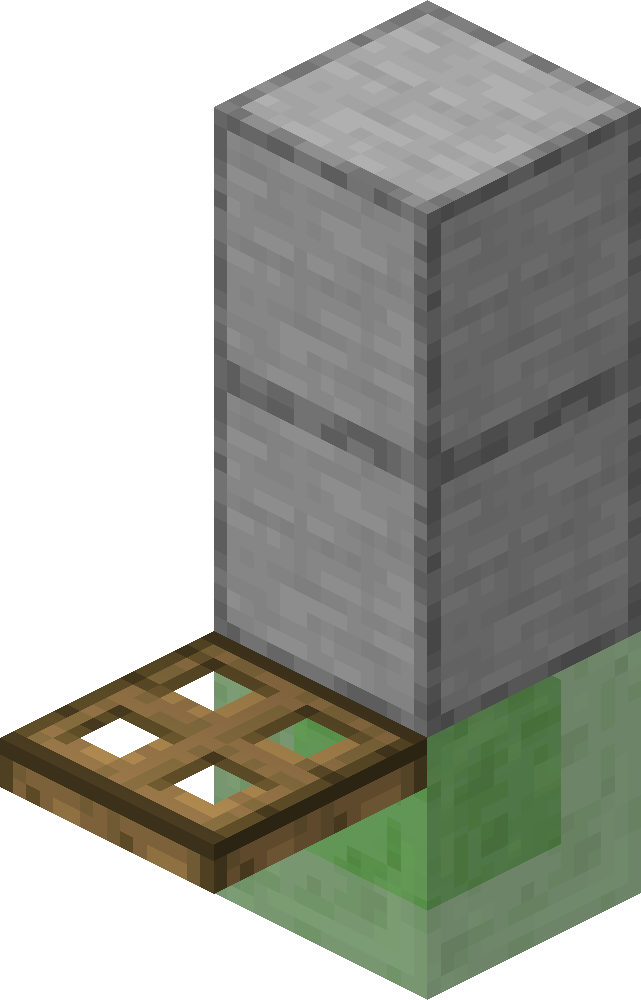

# Bouncy-ness

There are currently 3 blocks subject to the bouncy-ness property, **slime block, bed** and the newly added **shelf mushroom**.

These blocks only bounce the player if they land on its top surface while moving downward, with vertical velocity $V_y \le -0.08$. Landing any slower results in the player simply coming to rest on the surface.

In Java Edition 1.8.9, the game simply reverses the player's vertical velocity upon landing ($V_y = -V_y$). As a result, players jumping from **different heights** will bounce to the **exact same height** as long as they happen to land within the same tick.

To solve this issue, Bedrock Edition records the player's **actual fall distance $|\Delta Y|$** within the landing tick before contact, and uses it to calculate the true impact speed. With bounce factor $b = 1$ (for slime) and gravity $g = -0.08$, the bounce is calculated through the following steps:

- **Phase 1: Landing**  
  Based on the actual fall distance $|\Delta Y|$, the downward speed at impact $|V_{\text{hit}}|$ and the time elapsed $t$ within this tick before landing are:

  $\displaystyle |V_{\text{hit}}| = \sqrt{V_y^2 + 2\lvert g\rvert\lvert\Delta Y\rvert}$

  $\displaystyle t = \frac{|V_{\text{hit}}| - |V_y|}{|g|} \qquad (0 \le t < 1)$

- **Phase 2: Bounce**  
  The landing speed is reflected upward. Because landing consumed $t$ of the tick, the player travels upward under gravity for the remaining $1 - t$ duration:

  $$V_y = b \cdot |V_{\text{hit}}| + g(1 - t)$$

- **Phase 3: Air Drag**  
  Air drag is applied at the end of the tick as usual:

  $$V_y = 0.98\,V_y$$

- **Phase 4: Jump Check**  
  If the player jumped within the same tick, the final velocity takes the larger of the jump speed and the bounce speed:

  $$V_y = \max(V_{\text{jump}},\, V_y)$$

**Note:**  
In the tick where a bounce is triggered, the standard discrete gravity step $V_y = 0.98(V_y + g)$ is completely replaced by the process above.

## Bounce factor value

**Slime Block**\
`b = 1.0`

**Bed**\
`b = 0.75`

**Shelf Mushroom**\
Most likely the same bounce factor as bed, this has not been verified.[Todo]

## Retrieving the Bounce Factor

Upon landing, the game does not directly read the bounce factor of the block immediately beneath the player's feet; instead, it uses a specific set of detection rules to determine which block's bounce factor to retrieve. For instance, when a bouncy block is covered by certain low-profile blocks (such as carpets or trapdoors), landing on these coverings can still trigger a bounce, with the rebound velocity calculated through the exact same process described above. The specific detection process is as follows:

**1. Collecting Candidate Blocks Beneath the Player**

Let the player's bounding box in the tick **before** landing be $\text{AABB} = \lbrace\text{minX}, \text{minY}, \text{minZ}, \text{maxX}, \text{maxY}, \text{maxZ}\rbrace$. The game expands its vertical bounds to construct a detection volume—extending the bottom face downward:

$$\text{AABB.minY} = \text{AABB.minY} - \max(\text{stepHeight} \times 1.01,\; \vert V_y\vert + 0.2)$$

and extending the top face upward:

$$\text{AABB.maxY} = \text{AABB.maxY} + \max(\text{stepHeight},\; 0.08)$$

Any block whose bounding box intersects with this expanded $\text{AABB}$ is added to the candidate list.

**2. Selecting the Block for Bounce Calculation**

Let the player's Y-coordinate upon landing be $Y$, and the vertical center of a candidate block's bounding box be $\text{centerY} = (\text{minY} + \text{maxY}) / 2$.

Iterating through the candidate list, first exclude any block whose **bounding box center is higher** than $0.2$ blocks below the player's feet ($\text{centerY} > Y - 0.2$); among the remaining blocks, select the one whose **vertical center** is closest to $Y - 0.2$ (if tied vertically, choose the block whose **horizontal center** is strictly closer to the player's).

If no block qualifies after filtering, the player is considered not to have stepped on any block; otherwise, the game retrieves the bounce factor $b$ of the selected block, triggering a bounce via the process above when $b > 0$, or landing normally otherwise.

From the process above, we can draw several corollaries:

1. **Bouncing cannot be triggered through blocks with height $h \ge 0.4$:** When landing on a covering block of height $h$, its vertical center is $\text{centerY} = Y - h/2$; the covering block is excluded only when $\text{centerY} > Y - 0.2 \iff Y - h/2 > Y - 0.2 \iff h < 0.4$, allowing the bouncy block underneath to take effect.

2. **Valid coverings ($h < 0.4$) may still fail to bounce from certain fall heights:** Step 1 uses the player's bounding box from the tick **before** landing; if the fall distance within that tick plus the covering's thickness exceeds the downward expansion depth $\max(\text{stepHeight} \times 1.01,\; \vert V_y\vert + 0.2)$, the slime block underneath will not be collected into the candidate list, which is especially noticeable when covered by $0.375$-block-high snow (3 snow layers).

3. **Placing normal blocks adjacent to a slime block shrinks its effective bounce boundary by $0.3$ blocks ($0.6$ blocks for top slabs):** The player's horizontal bounding box is $0.6$ blocks wide, normally allowing bounces even when the player's center overhangs the slime block's edge by up to $0.3$ blocks. When a full block is placed right next to it, both share **the same vertical center** of $Y - 0.5$, so once the player's center crosses the boundary between the two blocks, the full block wins by being closer horizontally, shrinking the bounce range inward by $0.3$ blocks;

   if a top slab is placed instead, its vertical center is $Y - 0.25$, which is both below $Y - 0.2$ and **closer to the probe height** than the slime block ($Y - 0.5$), meaning it overrides the slime block the moment the player's bounding box touches it—shrinking the effective bounce range by a total of $0.6$ blocks.

## Glitch

In certain situations, setups where it seems impossible to step on the slime block can still bounce the player. The image below shows a working setup:

  

When the player lands on the trapdoor while pressing against the wall and **moving toward the slime block**, they will bounce as if stepping directly on the slime block; if they merely touch the wall without moving toward the slime block, no bounce occurs. The underlying mechanism is roughly as follows:

When the player lands while moving forward, the game unexpectedly **collects the slime block** beneath the wall into the candidate list[Needs verification.]; during block selection, because the trapdoor has a thickness of only $0.1825$, its vertical center is clearly **higher than** $0.2$ blocks below the player, so the game ultimately selects the slime block as the bounce block.

Trapdoors are not the only blocks capable of triggering this glitch. Let the slime block occupy the vertical range $[0, 1]$ (with its top surface at $1$ and vertical center at $0.5$), and let the block adjacent to the slime block have top surface height $y$ and thickness $h$. For the slime block to win out, the probe height must first be no lower than the slime block's vertical center:

$$y - 0.2 \ge 0.5 \iff y \ge 0.7$$

Second, the adjacent block must satisfy one of two conditions—either its vertical center is higher than the probe height:

$$y - h/2 > y - 0.2 \iff h < 0.4$$

or its vertical center is farther from the probe height than the slime block's vertical center is:

$$(y - 0.2) - 0.5 < (y - 0.2) - (y - h/2) \iff y - h/2 < 0.5$$

Therefore, besides trapdoors, enchanting tables, lecterns, and chests placed right next to the slime block (satisfying $y \ge 0.7$ with a center below $0.5$), or even a daylight detector placed next to the upper wall (satisfying $h < 0.4$), can all trigger a bounce.   