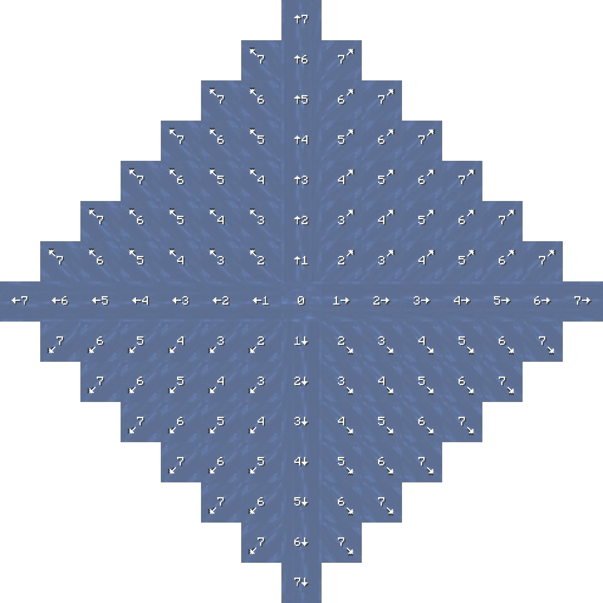
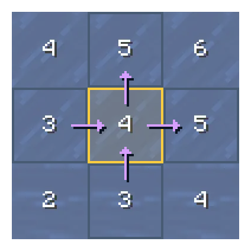

# Fluids

## Effect Box

Fluids do not have collision boxes like regular blocks. Instead, the game determines whether a player is in a fluid by **contracting the player's bounding box and checking for an intersection with the fluid's block grid**:

First, the player's $[0.6, 1.8, 0.6]$ bounding box is duplicated and contracted inward by 0.1 blocks on each horizontal side and 0.4 blocks at both the top and bottom, resulting in a reduced $[0.4, 1.0, 0.4]$ bounding box for detection.

Next, the game checks whether this contracted bounding box intersects with the $1 \times 1 \times 1$ block space occupied by the fluid: if they intersect, the player is considered inside the fluid; otherwise, they are not.

As shown above, this process only checks the full $1 \times 1 \times 1$ block space occupied by the fluid, **completely independent of the fluid's visual surface height**. Consequently, even when fluids appear at different heights visually, their actual effect boxes remain identical.

## Vertical Motion

In fluids, vertical velocity is calculated in a different order than in air: while airborne motion **applies gravity first and then multiplies the total by drag**, fluid motion **multiplies by drag first and then adds gravity separately**.

The recurrence relation for vertical velocity in a fluid is as follows:

$$V_{y,t} = d \cdot V_{y,t-1} + g$$

Water and lava have different drag and gravity coefficients:

- **Water**: Vertical drag coefficient $d = 0.8$, gravitational acceleration $g = -0.005$, and a terminal sinking velocity of $-0.025$.
- **Lava**: Vertical drag coefficient $d = 0.5$, gravitational acceleration $g = -0.02$, and a terminal sinking velocity of $-0.04$.

### Ascending & Descending

When the player holds the Jump or Sneak key while in a fluid, their vertical velocity increases or decreases by an additional 0.04 per tick, modifying the vertical velocity formula to:

```math
$$V_{y,t} = d \cdot V_{y,t-1} + g + \begin{cases} 0.04 & \text{Jump},\\ -0.04 & \text{Sneak},\\ 0 & \text{Otherwise}. \end{cases}$$
```

## Horizontal Motion

The horizontal motion formula in fluids shares the same structure as airborne motion; for comparison, the horizontal velocity formula in air is:

$$V_{H,t} = \underbrace{V_{H,t-1} \times S_{t-1} \times 0.91}_{\text{Momentum}} + \underbrace{0.02 \times M_t}_{\text{Acceleration}}$$

In a fluid, the horizontal velocity formula is:

$$V_{H,t} = \underbrace{V_{H,t-1} \times \rho_t}_{\text{Momentum}} + \underbrace{0.02 \times M'_t}_{\text{Acceleration}}$$

Here, the horizontal fluid drag coefficient $\rho$ takes the following values:

```math
$$\rho = \begin{cases} 0.9 & \text{Water (Sprinting)} \\ 0.8 & \text{Water (Walking)}\\ 0.5 & \text{Lava} \end{cases}$$
```

The primary differences between the two lie in the following two terms:

- **Acceleration term**: While sprinting in air multiplies the movement multiplier $M_t$ by 1.3, sprinting in a fluid has no effect on player acceleration ($M'_t$ retains its normal walking value). Instead, the speed boost from sprinting in water comes entirely from the change in the drag coefficient $\rho$ (increasing from 0.8 to 0.9).
- **Momentum (drag) term**: Airborne motion accounts for the underlying block's slipperiness $S_{t-1}$ and air drag (0.91), whereas fluid motion ignores block slipperiness and determines the drag coefficient $\rho$ solely from the fluid type and movement state.

### Depth Strider

The Depth Strider enchantment (with level denoted as $L$) does not simply reduce water drag; rather, it **linearly interpolates both water drag and base acceleration toward normal ground movement parameters** by a factor of $h$.

First, the interpolation factor $h$ is calculated as:

```math
$$h = \begin{cases} \dfrac{\min(L, 3)}{3} & \text{On ground} \\ \dfrac{1}{2} \cdot \dfrac{\min(L, 3)}{3} & \text{Off ground} \end{cases}$$
```

Let $\rho$ be the unenchanted base water drag (0.8 for walking, 0.9 for sprinting); the enchantment modifies both terms in the horizontal formula simultaneously:

1. **Interpolating the drag coefficient $\rho$ toward normal ground friction ($0.6 \times 0.91 = 0.546$)**:

$$\rho' = \rho + (0.546 - \rho) \cdot h$$

*(Note: If the player is affected by a mechanic that sets the swim speed multiplier above 1.0, such as Dolphin's Grace, the game engine skips this drag interpolation and keeps $\rho' = \rho$.)*<sup>[Needs verification.]</sup>

1. **Interpolating the base acceleration coefficient from 0.02 toward the player's ground movement speed**:

   Let $a$ denote the modified base acceleration coefficient; here, the $1.3\times$ sprinting multiplier is factored back into the ground movement speed, and $a$ is linearly interpolated from 0.02 toward that value:
```math
   $$a = 0.02 + \left(0.1\times \left. \begin{cases} 1 & \text{Walking}\\ 1.3 & \text{Sprinting} \end{cases} \right\} - 0.02\right) \cdot h$$
```
The horizontal velocity formula can then be rewritten as:

$$V_{H,t} = \underbrace{V_{H,t-1} \times \rho'_t}_{\text{Momentum}} + \underbrace{a_t \times M'_t}_{\text{Acceleration}}$$

## Swimming

Generally, a player must press Forward and Sprint simultaneously in water at least two blocks deep to enter the swimming state. However, once in the swimming state, neither sprinting nor swimming is interrupted as long as not all movement keys are released at once—meaning a player can swim backward at the exact same speed as swimming forward. Furthermore, the swimming pose has no additional effect on horizontal velocity, which still follows the horizontal motion formula described above.

Upon entering the swimming pose, the game no longer applies the standard 0.005 downward water gravity; instead, **vertical velocity is governed by the camera pitch angle $\theta$ (positive when looking down, negative when looking up)**, approaching the target vertical velocity $\sin(-\theta)$ along the look vector by a factor of $k_t$ from the drag-adjusted velocity $0.8 \, V_{y,t-1}$ each tick:

```math
$$V_{y,t} = 0.8 \, V_{y,t-1} + k_t\times\bigl(\sin(-\theta) - 0.8 \, V_{y,t-1}\bigr) + \begin{cases} 0.04 & \text{Jump}\\ -0.04 & \text{Sneak}\\ 0 & \text{Otherwise} \end{cases}$$
```

Here, the coefficient $k_t$ takes the following values:

```math
$$k_t=\begin{cases} 1.3 & \text{Flying}\\ 0.085 & \sin{(-\theta)} < -0.2\\ 0.06 & \sin{(-\theta)} \ge -0.2 \end{cases}$$
```

At the threshold condition $\sin(-\theta) = -0.2$, the corresponding downward pitch angle is $\theta \approx 11.537^\circ$.

## Flow Thrust

Before calculating flow thrust, it is necessary to understand the underlying concept of **fluid depth (`fluid_depth`)**. **The depth value represents how much "empty space" exists at the top of a fluid block—the larger the value, the shallower the fluid**—following these rules:

- **Source blocks** have a fixed depth value of 0, representing a full block.
- **Horizontal spreading**: Water increases its depth value by 1 for each block it spreads outward ($1 \to 2 \to \dots \to 7$) and stops spreading horizontally once it reaches the maximum value of 7 (the thinnest layer). Lava in the Nether also increments by 1 per block and spreads up to 7 blocks, whereas in the Overworld and the End it increments by 2 per block ($0 \to 2 \to 4 \to 6$), spreading at most 3 blocks.
- **Vertically falling** fluids (waterfalls) are always treated as having a depth value of 0 (equivalent to a full block) when calculating horizontal flow direction.

When a single water source block spreads naturally on flat ground, the depth value and flow direction of each water block are as shown below:


<p align="center">
  
</p>

Each tick, the game calculates the pushing force exerted by fluids on the player in **three steps**:

**1. Calculating Single-Block Horizontal Flow from Neighboring Depth Differences**

Each fluid block checks its **four horizontally adjacent blocks (east, west, south, and north)** in turn and generates push vectors pointing from lower depth values to higher depth values (i.e., from upstream to downstream) based on their depth differences, then sums and normalizes these vectors. Take the diagram below as an example:

<p align="center">
  
</p>

For the central water block with a depth of 4, the adjacent blocks to its left and bottom have a depth value of 3 (1 less than 4), generating unit push vectors pointing right and up, respectively. Meanwhile, the adjacent blocks to its right and top have a depth value of 5 (1 greater than 4), which likewise generate unit push vectors pointing right and up, respectively. The resulting four component vectors are shown as purple arrows in the diagram. Defining right as the positive $X$-axis and up as the positive $Z$-axis, the summed horizontal push vector is $(2, 0, 2)$, which normalizes to the horizontal flow vector $\left(\frac{1}{\sqrt{2}}, 0, \frac{1}{\sqrt{2}}\right)$.

**2. Downward Push from Wall-Adjacent Falling Fluids**

After normalizing the horizontal push vector above, if the current fluid block **is itself falling vertically (not a source block)** and **any solid block exists in its four horizontally adjacent positions (or one block directly above those adjacent positions)**, the game adds an extra downward vector of **$(0, -6, 0)$** to the normalized horizontal vector and **normalizes the result again** to obtain the block's final unit flow vector.

<p align="center">
  
</p>

*(Note: The yellow wireframes in the diagram highlight the 8 positions checked by the central falling water block.)*

**3. Multi-Block Vector Summation and Thrust Constant Multiplication**

When a player touches multiple fluid blocks simultaneously, the game sums the unit flow vectors of all touched blocks, **normalizes the sum again** into a total direction vector $\hat{u}$, and multiplies it by the fluid thrust constant $k_f$ each tick before adding it directly to the player's 3D velocity:

```math
$$\vec{V} \mathrel{+}= k_f \cdot \hat{u}, \qquad k_f = \begin{cases} 0.014 & \text{Water} \\ 0.0035 & \text{Lava} \end{cases}$$
```

Note that fluid thrust is applied before fluid drag (the inertia term) is calculated. Formally, letting $d$ denote the drag coefficient and $\vec{a}_t$ denote the player's own acceleration, the complete single-tick velocity update order is:

$$\vec{V}_t=d\cdot(\vec{V}_{t-1}+\hat{u}_{t-1})+\vec{a}_t$$

## Fluid Blip<sup>[Todo]</sup>

Essentially identical to Java Edition 1.8.9<sup>[Needs verification.]</sup> ([Water Blips and the Water +2 - YouTube](https://www.youtube.com/watch?v=_ZcuHIsVlq0)).   